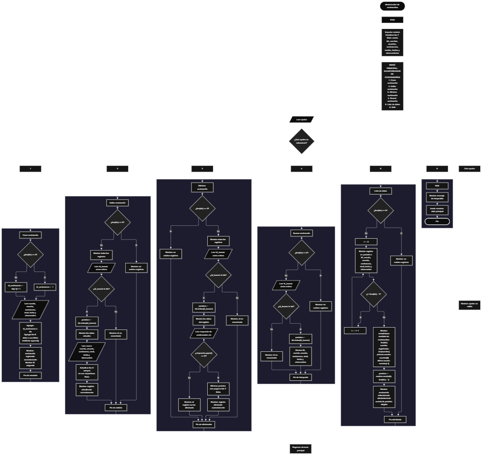

 

Este proyecto, llamado <b>aleatorizador de contraseñas</b>, fue desarrollado en <b>python</b> como un ejercicio práctico para fortalecer la lógica de programación mediante la creación de un sistema de gestión de contraseñas desde la consola. El programa cuenta con un menú principal de seis opciones que permite <b>crear, editar, eliminar, buscar, listar y seleccionar aleatoriamente</b> registros de contraseñas almacenados durante la ejecución. Cada registro contiene información como el nombre de la cuenta, el usuario, la contraseña, el nivel de seguridad, la fecha y las observaciones, utilizando siete listas paralelas para organizar los datos. Durante su desarrollo se aplicaron conceptos fundamentales de programación, como variables, listas, estructuras condicionales, ciclos repetitivos, operaciones con listas y generación de números aleatorios mediante el módulo <b>random</b>. Este proyecto permite poner en práctica los conocimientos adquiridos en python y sirve como base para desarrollar sistemas de gestión más avanzados utilizando otros lenguajes y tecnologías.

<h2 align="center">⚙️ Funcionamiento del menú principal</h2>

### ➕ Crear contraseña

La opción <b>1) crear contraseña</b> permite registrar una nueva contraseña asociada a una cuenta. Antes de realizar el registro, el programa comprueba si la lista <b>ids</b> está vacía mediante la condición <b>len(ids) == 0</b>. Si no existen registros, asigna el identificador <b>1</b> a la nueva contraseña. En caso contrario, obtiene el último identificador almacenado mediante <b>ids[-1]</b> y le suma uno para generar el siguiente ID. Después, solicita el <b>nombre de la cuenta, usuario, contraseña, nivel de seguridad, fecha y observación</b>. Los datos se almacenan en las listas <b>ids, cuentas, usuarios, contrasenas, niveles, fechas y observaciones</b>, utilizando el método <b>append()</b> para agregar cada valor. Finalmente, muestra el mensaje <b>"contraseña registrada correctamente."</b> e informa el identificador asignado. Los registros permanecen almacenados en memoria mientras el programa continúa en ejecución.

### ✏️ Editar contraseña

La opción <b>2) editar contraseña</b> permite modificar la información de una contraseña registrada. Primero, el programa comprueba si existen registros mediante la condición <b>len(ids) == 0</b>. Si no hay información almacenada, muestra el mensaje <b>"no existen registros."</b>. En caso contrario, presenta una lista con el ID, la cuenta, el usuario, la contraseña, el nivel de seguridad, la fecha y las observaciones de cada registro. Después, solicita el identificador mediante <b>int(input())</b> y comprueba si existe utilizando la condición <b>id_buscar in ids</b>. Si el ID se encuentra registrado, utiliza <b>ids.index(id_buscar)</b> para obtener la posición correspondiente, muestra los datos actuales y solicita la nueva información de los seis campos descriptivos. Los valores se actualizan directamente en sus respectivas listas, mientras que el identificador permanece sin cambios. Finalmente, muestra el mensaje <b>"registro actualizado correctamente."</b>. Si el ID no existe, presenta el mensaje <b>"id no encontrada."</b>.

### 🗑️ Eliminar contraseña

La opción <b>3) eliminar contraseña</b> permite eliminar un registro mediante su identificador. Primero, comprueba si existen datos almacenados. Si las listas están vacías, muestra el mensaje <b>"no existen registros."</b>. Si hay registros disponibles, presenta la información de todas las contraseñas para facilitar la identificación del registro que se desea eliminar. Después, solicita el ID, lo convierte a un número entero y verifica su existencia mediante <b>id_buscar in ids</b>. Si el identificador es válido, obtiene su posición utilizando <b>ids.index(id_buscar)</b> y muestra los datos del registro seleccionado. A continuación, solicita confirmación mediante la pregunta <b>"¿desea eliminar este registro? (s/n):"</b>. Si la respuesta es <b>"s"</b> o <b>"S"</b>, la condición <b>respuesta.upper() == "S"</b> permite confirmar la operación. El programa utiliza <b>pop(posicion)</b> para eliminar los elementos correspondientes de las siete listas, manteniendo alineada la información de los registros restantes. Finalmente, muestra el mensaje <b>"registro eliminado correctamente."</b>. Si el usuario no confirma la operación, presenta el mensaje <b>"el registro no fue eliminado."</b>. Si el ID no existe, muestra <b>"id no encontrada."</b>.

### 🔎 Buscar contraseña

La opción <b>4) buscar contraseña</b> permite localizar un registro mediante su identificador. Antes de iniciar la búsqueda, el programa comprueba si existen registros utilizando la condición <b>len(ids) == 0</b>. Si no hay datos almacenados, muestra el mensaje <b>"no existen registros."</b>. En caso contrario, solicita el identificador y lo convierte a un número entero. Después, utiliza la condición <b>id_buscar in ids</b> para comprobar si el ID se encuentra en la lista. Si existe, obtiene su posición mediante <b>ids.index(id_buscar)</b> y muestra el ID, la cuenta, el usuario, la contraseña, el nivel de seguridad, la fecha y las observaciones correspondientes. Si no encuentra el identificador solicitado, presenta el mensaje <b>"id no encontrada."</b>. Esta función permite consultar un registro específico sin necesidad de recorrer visualmente toda la lista.

### 📋 Lista de datos

La opción <b>5) lista de datos</b> permite consultar los registros almacenados, obtener estadísticas básicas y seleccionar aleatoriamente una contraseña registrada. Primero, el programa comprueba si existen datos mediante la condición <b>len(ids) == 0</b>. Si no hay registros, muestra el mensaje <b>"no existen registros."</b>. Si existen datos, utiliza un ciclo <b>for</b> junto con <b>range(len(ids))</b> para recorrer las posiciones de las listas y mostrar el identificador, la cuenta, el usuario, la contraseña, el nivel de seguridad, la fecha y las observaciones de cada registro. Después, presenta las estadísticas del programa: la cantidad de contraseñas mediante <b>len(ids)</b>, la cantidad de registros de cuentas mediante <b>len(cuentas)</b>, la primera cuenta mediante <b>cuentas[0]</b> y la última cuenta mediante <b>cuentas[-1]</b>. Finalmente, utiliza el módulo <b>random</b> y la función <b>random.randint(0, len(ids) - 1)</b> para seleccionar una posición aleatoria. Con esa posición, muestra todos los datos del registro elegido. Esta operación selecciona una contraseña existente y no genera una nueva contraseña aleatoria.

### 🚪 Salir del menú principal

La opción <b>6) salir</b> permite finalizar la ejecución del programa. Cuando el usuario selecciona esta opción, el sistema muestra el mensaje <b>"gracias por utilizar el aleatorizador de contraseñas."</b> y utiliza la instrucción <b>break</b> para terminar el ciclo <b>while True</b> que mantiene activo el menú principal. Al finalizar el programa, las listas utilizadas para almacenar los registros dejan de estar disponibles, ya que el código actual no implementa un sistema de almacenamiento permanente en archivos o bases de datos.

<h2 align="center">🧠 Temas aplicados en el proyecto</h2>

### 📦 Variables

En este proyecto se utilizan variables para controlar la opción seleccionada en el menú, generar identificadores, almacenar los datos introducidos por el usuario, localizar registros, controlar posiciones dentro de las listas y guardar la respuesta de confirmación durante la eliminación. Cada variable cumple una función específica dentro de las operaciones de gestión de contraseñas.

🔢 **Opcion:** Almacena la opción seleccionada por el usuario en el menú principal.

🆔 **Id_contrasena:** Almacena el identificador asignado al nuevo registro de contraseña.

🔎 **Id_buscar:** Guarda el identificador introducido por el usuario para buscar, editar o eliminar un registro.

📝 **Cuenta:** Almacena el nombre de la cuenta asociada a la contraseña.

👤 **Usuario:** Almacena el nombre de usuario correspondiente al registro.

🔐 **Contrasena:** Almacena la contraseña introducida para la cuenta.

🛡️ **Nivel:** Almacena el nivel de seguridad indicado por el usuario.

📅 **Fecha:** Almacena la fecha asociada al registro.

📄 **Observacion:** Almacena las observaciones adicionales de la contraseña.

🔄 **I:** Funciona como variable de control en los ciclos <b>for</b> utilizados para recorrer las listas y mostrar los registros.

📍 **Posicion:** Almacena el índice de un registro encontrado o la posición seleccionada aleatoriamente.

✅ **Respuesta:** Almacena la confirmación introducida por el usuario antes de eliminar un registro.

### 🗃️ Listas

En este proyecto se utilizan siete listas paralelas para almacenar los datos de las contraseñas registradas. Cada lista contiene un tipo de información y utiliza la misma posición para representar los datos de un mismo registro. Por ejemplo, los datos de una contraseña ubicada en la posición <b>0</b> se encuentran distribuidos entre <b>ids[0], cuentas[0], usuarios[0], contrasenas[0], niveles[0], fechas[0] y observaciones[0]</b>. Esta organización permite recorrer, buscar, modificar, mostrar y eliminar registros manteniendo la correspondencia entre sus datos. Las listas son dinámicas, por lo que pueden aumentar o disminuir de tamaño durante la ejecución del programa.

🆔 **Ids:** Almacena los identificadores de los registros.

📝 **Cuentas:** Almacena los nombres de las cuentas asociadas a las contraseñas.

👤 **Usuarios:** Almacena los nombres de usuario de cada cuenta.

🔐 **Contrasenas:** Almacena las contraseñas registradas.

🛡️ **Niveles:** Almacena los niveles de seguridad indicados para cada registro.

📅 **Fechas:** Almacena las fechas asociadas a las contraseñas.

📄 **Observaciones:** Almacena las observaciones adicionales de cada registro.

### 🔀 Estructuras condicionales

En este proyecto se utilizan las estructuras <b>if, elif y else</b> para controlar las opciones del menú y tomar decisiones según el estado de los registros. Estas estructuras permiten comprobar si las listas están vacías, determinar si un identificador existe, decidir si se actualiza o elimina un registro y comprobar si el usuario confirma la eliminación. También permiten mostrar el mensaje <b>"opción no válida."</b> cuando la selección introducida no coincide con ninguna de las opciones disponibles. De esta manera, el programa ejecuta diferentes instrucciones según el resultado de cada condición.

### 🔄 Estructuras repetitivas

En este proyecto se utilizan los ciclos <b>while</b> y <b>for</b>. El ciclo <b>while True</b> mantiene activo el menú principal y permite ejecutar repetidamente las operaciones disponibles hasta que se utiliza <b>break</b> para salir. Por otra parte, los ciclos <b>for</b> recorren los registros almacenados mediante <b>range(len(ids))</b>, permitiendo mostrar los datos de cada contraseña durante las operaciones de edición, eliminación y listado. Estas estructuras facilitan la ejecución repetida de instrucciones y el procesamiento de múltiples registros.

### 🎯 Estructura de selección

El programa utiliza una estructura de selección basada en <b>if, elif y else</b> para evaluar el valor almacenado en la variable <b>opcion</b>. Cada condición corresponde a una operación específica del menú principal: <b>crear contraseña, editar contraseña, eliminar contraseña, buscar contraseña, lista de datos o salir</b>. Cuando el valor introducido no coincide con ninguna de las opciones definidas, el bloque <b>else</b> muestra el mensaje <b>"opción no válida."</b>. Esta organización permite separar las funcionalidades y facilitar la lectura del código.

### 🧰 Métodos y operaciones con listas

El proyecto utiliza distintos métodos y operaciones de python para administrar los registros almacenados. El método <b>append()</b> agrega nuevos datos al final de cada lista durante el registro de una contraseña. El método <b>index()</b> permite localizar la posición correspondiente a un identificador existente, mientras que <b>pop()</b> elimina los elementos de esa posición durante la operación de eliminación. La condición <b>in</b> permite comprobar si un identificador se encuentra registrado, y la función <b>len()</b> determina la cantidad de elementos de una lista. También se utiliza la indexación negativa, como <b>ids[-1]</b> y <b>cuentas[-1]</b>, para acceder al último elemento almacenado, así como <b>cuentas[0]</b> para consultar el primero.

### 🎲 Generación de números aleatorios

El programa importa el módulo <b>random</b> para seleccionar aleatoriamente uno de los registros existentes. Durante la opción de listado, la función <b>random.randint(0, len(ids) - 1)</b> genera un número entero dentro del rango de posiciones válidas de la lista. El resultado se almacena en la variable <b>posicion</b>, que se utiliza para mostrar los datos de la contraseña seleccionada. La selección se realiza entre los registros disponibles y no modifica su contenido. Esta funcionalidad permite practicar el uso de números aleatorios y la selección de elementos de una lista.

### 🔢 Conversión de datos

El programa utiliza la función <b>int()</b> para convertir el identificador introducido por el usuario en un número entero durante las operaciones de edición, eliminación y búsqueda. Esta conversión permite comparar el valor ingresado con los identificadores almacenados en la lista <b>ids</b>. Sin embargo, el código actual no incluye un manejo de errores para las entradas que no puedan convertirse a números enteros.

<h2 align="center">¿Cómo se implementaron las operaciones crud en el proyecto?</h2>

Las operaciones <b>crud</b> se implementaron mediante las opciones del menú principal para administrar las contraseñas registradas. La operación <b>crear</b> corresponde a <b>crear contraseña</b>, donde se solicita la información de una nueva cuenta y se almacena en las siete listas. La operación <b>leer</b> se realiza mediante las opciones <b>buscar contraseña y lista de datos</b>, que permiten consultar un registro específico o visualizar todos los registros existentes. La operación <b>actualizar</b> corresponde a <b>editar contraseña</b>, donde se modifican los datos descriptivos de un registro sin cambiar su identificador. Por último, la operación <b>eliminar</b> corresponde a <b>eliminar contraseña</b>, donde se solicita confirmación y se eliminan los elementos correspondientes de las listas. Estas operaciones permiten gestionar los registros durante la ejecución del programa.

<h2 align="center">Diagrama de flujo del proyecto</h2>

<h2 align="center">🛡️ Validaciones del programa</h2>

### 📭 No existen registros

Esta comprobación se utiliza en las opciones de <b>editar contraseña, eliminar contraseña, buscar contraseña y lista de datos</b>. El programa verifica si la lista <b>ids</b> está vacía mediante la condición <b>len(ids) == 0</b>. Si no existen registros, muestra el mensaje <b>"no existen registros."</b> y evita continuar con la operación seleccionada. Esta comprobación permite controlar las operaciones que necesitan información previamente almacenada.

### 🔎 Identificador no encontrado

Esta comprobación se utiliza durante las operaciones de edición, eliminación y búsqueda. El programa verifica si el identificador introducido se encuentra en la lista <b>ids</b> mediante la condición <b>id_buscar in ids</b>. Si el ID existe, utiliza <b>ids.index(id_buscar)</b> para obtener su posición y continuar con la operación correspondiente. Si no se encuentra, muestra el mensaje <b>"id no encontrada."</b>. Esta comprobación permite evitar que el programa intente modificar, eliminar o consultar un registro mediante un identificador inexistente.

### ⚠️ Confirmación de eliminación

Esta comprobación se utiliza en la opción <b>eliminar contraseña</b>. Después de mostrar los datos del registro seleccionado, el programa solicita confirmación al usuario. La condición <b>respuesta.upper() == "S"</b> permite aceptar la letra <b>s</b> en mayúscula o minúscula. Si se confirma la operación, se eliminan los elementos correspondientes de las siete listas. En caso contrario, se muestra el mensaje <b>"el registro no fue eliminado."</b> y se conservan los datos del registro seleccionado.

### 🔢 Identificador numérico

En las operaciones de edición, eliminación y búsqueda, el programa utiliza <b>int(input())</b> para convertir el identificador introducido por el usuario en un número entero. Esta conversión permite comparar el valor ingresado con los elementos almacenados en <b>ids</b>. Sin embargo, el código actual no comprueba si el usuario introduce letras, símbolos u otros valores que no puedan convertirse a un número entero. En esos casos, python puede generar un error y detener la ejecución del programa.

### ⚠️ Opción inválida

El menú principal incluye una condición <b>else</b> que muestra el mensaje <b>"opción no válida."</b> cuando el valor introducido no coincide con ninguna de las opciones definidas entre <b>1</b> y <b>6</b>. Esta comprobación permite informar al usuario de que debe seleccionar una de las opciones disponibles. El ciclo principal continúa activo para que pueda volver a introducir una opción.

### 🔐 Protección y almacenamiento de contraseñas

El código actual almacena las contraseñas como texto normal dentro de la lista <b>contrasenas</b> y las muestra directamente durante las operaciones de listado, búsqueda, edición y eliminación. No se implementan mecanismos de cifrado, ocultación de contraseñas ni almacenamiento permanente en archivos o bases de datos. Por este motivo, el proyecto debe considerarse un ejercicio educativo de gestión de registros y no un administrador de contraseñas preparado para almacenar credenciales reales.

### 🎲 Selección aleatoria de registros

La selección aleatoria se realiza en la opción <b>lista de datos</b>, después de comprobar que existen registros. La función <b>random.randint(0, len(ids) - 1)</b> selecciona una posición válida entre los elementos almacenados. El programa utiliza esa posición para mostrar la información del registro elegido. Esta operación selecciona una contraseña existente, pero no genera una contraseña nueva ni comprueba el nivel de seguridad de la contraseña seleccionada.

<h2 align="center">🎯 Objetivo del proyecto</h2>

El objetivo principal de este proyecto es fortalecer la <b>lógica de programación</b> mediante el desarrollo de un sistema de gestión de contraseñas en <b>python</b>. A través de su construcción se busca aplicar los conocimientos adquiridos sobre variables, listas, estructuras condicionales, ciclos repetitivos, operaciones con listas y generación de números aleatorios. Además, el proyecto permite comprender cómo registrar, consultar, modificar y eliminar información en una aplicación de consola, así como utilizar identificadores para localizar registros y mantener organizados los datos relacionados. Este ejercicio constituye una base para desarrollar aplicaciones más completas que incorporen almacenamiento permanente, validaciones adicionales y mecanismos de protección de credenciales.

